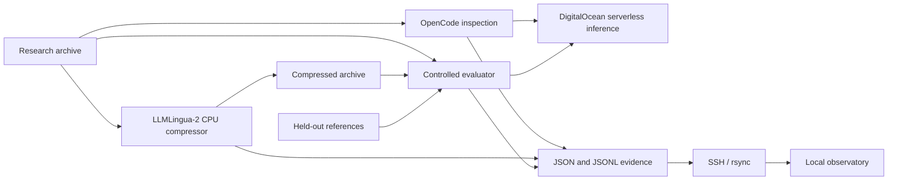

# Small Lab — AI Research Workbench

**A cloud workspace for small labs to run an AI-assisted research experiment and inspect the evidence behind its results.**

The workbench combines OpenCode on a DigitalOcean Droplet, actual Microsoft LLMLingua-2 prompt compression on CPU, and DeepSeek through DigitalOcean Serverless Inference. A local observatory displays the agent events, original and compressed context, raw answers, provider token usage, timings, and evaluation references.

The first experiment asks a practical question: **does shortening a research notebook reduce inference usage while preserving the information needed to answer research questions?** The answer in our recorded trial is mixed: input tokens decreased, but reasoning usage increased substantially and a deadline condition was omitted.

> **Project status:** working hackathon research prototype. Saved evidence and the complete experiment are available. This repository is not a production multi-user service, and its results do not reproduce the LLMLingua paper's published benchmark scores.

## Contents

- [Quick start: inspect saved evidence](#quick-start-inspect-saved-evidence)
- [Purpose and implemented features](#purpose-and-implemented-features)
- [Architecture and workflow](#architecture-and-workflow)
- [Recorded research results](#recorded-research-results)
- [Requirements and tested environment](#requirements-and-tested-environment)
- [Set up a fresh research Droplet](#set-up-a-fresh-research-droplet)
- [Run and reproduce the experiment](#run-and-reproduce-the-experiment)
- [Configuration](#configuration)
- [Evaluation methodology](#evaluation-methodology)
- [Evidence files and observability API](#evidence-files-and-observability-api)
- [Repository structure](#repository-structure)
- [Development and verification](#development-and-verification)
- [Security, data handling, and costs](#security-data-handling-and-costs)
- [Troubleshooting](#troubleshooting)
- [Judge demonstration](#judge-demonstration)
- [Production readiness and roadmap](#production-readiness-and-roadmap)
- [Contributing and support](#contributing-and-support)
- [Licensing and attribution](#licensing-and-attribution)

## Quick start: inspect saved evidence

This path requires **Python 3 only**. It does not need DigitalOcean credentials, SSH, a GPU, or the compressor packages, and it makes no inference calls.

```sh
git clone https://github.com/shipitdev/small-lab-research-workbench.git
cd small-lab-research-workbench
python3 observability/server.py
```

The repository is public; saved evidence can be inspected without cloud credentials.

Open **http://localhost:7777** and select `llmlingua-20261013-03`, the completed actual LLMLingua-2 experiment.

| View | What to inspect |
| --- | --- |
| Live workflow | Plain-language stage updates, the actual inspection answer, completed model answers, and final metrics |
| Overview | Workflow stages, input reduction, output usage, cache/reasoning usage, timings |
| Observability | Expandable workflow steps and native OpenCode JSON events |
| Evaluations | Five human references alongside original-context and compressed-context answers |
| Context | Exact archive text, compressed text, checkpoint revision, settings, source hashes |
| DigitalOcean | Historical account-wide observation, clearly separate from per-call evidence |

Open `http://localhost:7777/#workflow` for the live presentation. Keep **Follow newest run** checked before starting `bash scripts/demo.sh`; the panel automatically switches to a new run and shows each answer as it is synchronized. Selecting a saved run disables following so you can inspect it without being moved. Final metrics appear only after the complete result is saved. The descriptions summarize recorded actions and outputs, not private model reasoning. The live final metrics also show provider-reported reasoning tokens separately; these are already included in output usage.

The browser polls the read-only evidence endpoint every five seconds. Press `Ctrl+C` in the server terminal to stop it. To use a different port:

```sh
python3 observability/server.py --port 7778
```

The demo script's printed URL still refers to port 7777; use your selected port when opening the browser.

## Purpose and implemented features

Small research groups may want to try an existing AI research component without building a large model-serving system. This project supplies a bounded experiment, a managed inference connection, and evidence that can be inspected rather than relying on a headline metric.

Currently implemented:

- OpenCode inspection of a supplied synthetic research archive.
- Actual LLMLingua-2 token-classification compression using an official Microsoft checkpoint.
- CPU execution on an existing Droplet; no GPU provisioning or model training.
- A controlled comparison using the same fixed DeepSeek model for both contexts.
- Five held-out questions with manually prepared reference answers.
- Exact submitted model messages, provider usage, timestamps, identifiers, source hashes, and latency measurements.
- A read-only localhost observatory with separate traces, context, and evaluation views.
- SSH-based execution and periodic evidence synchronization to the local machine.
- Preservation of earlier baseline results and partial failed runs.

The current example is a **fictional RiverWatch lab** comparing two turbidity sensors. Its notebook includes an early recommendation, a later quality-control correction, a subgroup exception, a conditional purchasing deadline, and missing battery measurements. It is synthetic demonstration data, not a real sensor study.

## Architecture and workflow



| Component | Responsibility | Execution location |
| --- | --- | --- |
| DigitalOcean Droplet | Hosts the research files, harness, and CPU compressor | Cloud VM |
| OpenCode | Inspects the archive and emits native harness events | Droplet |
| LLMLingua-2 | Classifies and removes tokens from the archive | Droplet CPU |
| DigitalOcean Serverless Inference | Supplies the large candidate model through an API | Managed inference service |
| `evaluation/workflow.py` | Orchestrates inspection, compression, comparison, and evidence capture | Droplet |
| `evaluation/run_eval.py` | Sends paired questions and computes transparent metrics | Droplet, or standalone locally |
| `scripts/demo.sh` | Transfers experiment inputs, starts the workflow, syncs evidence | Local machine |
| `observability/server.py` | Reads local evidence and serves the observatory | Local machine |

### Order of execution

1. Create a new output directory; an existing directory is never reused by the workflow.
2. Read the research archive and record its SHA-256 hash.
3. Ask OpenCode to inspect the archive in at most 100 words. This is an inspection task; its answer is not the compressor input.
4. Save OpenCode's JSON events separately from the benchmark calls.
5. Load the pinned LLMLingua-2-small checkpoint on CPU with two PyTorch threads.
6. Compress the archive at a requested retained rate of `0.5`, preserving newline tokens and dropping consecutive forced-token repetitions.
7. Write the compressed archive and compressor metadata **before loading the evaluation references**.
8. Ask all five questions using the original context, then all five using the compressed context. Both sides use the same model, system instruction, temperature, and output allowance.
9. Save each completed call immediately, then write the final comparison and workflow completion event.
10. Synchronize the run to the local machine; the observatory reads the new evidence.

The complete workflow explicitly selects `digitalocean/deepseek-v4.1-flash` for OpenCode and the corresponding fixed inference model for evaluation. An operational router can remain configured as OpenCode's default for other work, but **this experiment does not benchmark the router**. It does not require a separate managed agent, harness runtime, microVM, database, or object-storage bucket.

Managed inference removes the need to serve the large model ourselves. The Droplet still requires ordinary VM administration and runs a small local compressor checkpoint.

## Recorded research results

The completed actual-compressor run is stored in [`evaluation/results/llmlingua-20261013-03/`](evaluation/results/llmlingua-20261013-03/). See its [manual review](evaluation/results/llmlingua-20261013-03/REVIEW.md) and [raw result](evaluation/results/llmlingua-20261013-03/result.json).

| Measurement | Original context | Compressed context |
| --- | ---: | ---: |
| Provider input tokens, summed over five calls | 4,359 | 2,524 |
| Provider output tokens, including reasoning | 622 | 7,817 |
| Reasoning tokens, a subset of output | 402 | 7,499 |
| Sum of measured request durations | 10.03 s | 100.92 s |
| Compressor tokenizer tokens | 772 | 407 |
| Archive size | 3,743 bytes | 1,999 bytes |

**Provider input reduction: 42.10%.** Compressor computation took **1.9441 seconds**, with a separate **4.3169 seconds** spent loading the cached checkpoint.

Manual review found that both contexts preserved the overall sensor preference and refused to invent battery life. The compressed answer weakened the explanation for excluding warm-up readings and **omitted the requirement to receive site permissions by 18 October** when stating the purchasing deadline.

This trial demonstrates that input compression can coexist with worse total token usage, slower responses, and lost conditions. It does not establish lower billed cost, faster inference, or equivalent answer quality. The timings come from one sequential trial with different cache behavior, not a controlled latency distribution.

### Earlier experiments

- [`llmlingua-20261013-02`](evaluation/results/llmlingua-20261013-02/) preserves a partial actual-compressor attempt that stopped after seven successful comparison calls at a 1,024-token output allowance. It has no completed `result.json`.
- The [earlier baseline report](evaluation/results/REPORT.md) describes agent-generated shortening with 28.33% fewer input tokens. That baseline was inspired by LLMLingua's efficiency question but **did not run its algorithm**.
- [DigitalOcean observability JSON](evaluation/results/digitalocean-observability.json) records an earlier manual dashboard observation. Its totals are historical and account-wide, not this experiment's bill.

## Requirements and tested environment

### To view saved evidence

- Python 3 and a modern web browser.
- Access to this repository.
- No third-party Python packages or frontend build process.

### To execute a fresh complete workflow

- A Linux Droplet with SSH access and outbound access to DigitalOcean inference, package registries, and the checkpoint host.
- Python virtual-environment support, `pip`, and `rsync` on the Droplet.
- OpenCode installed at `/root/.opencode/bin/opencode`, authenticated to the `digitalocean` provider.
- A DigitalOcean model access key authorized for the candidate model and available credits/billing.
- The isolated CPU compressor environment described below.
- On the local Mac/Linux machine: Bash, OpenSSH (`ssh` and `scp`), `rsync`, and Python 3 for the observatory.

The tested cloud environment used Python **3.12.3**, OpenCode **1.18.27**, **2 vCPUs / 8 GB RAM**, and a CPU-only runtime. This is a tested configuration, not a proven minimum requirement.

| Research dependency | Recorded version |
| --- | --- |
| `llmlingua` | `0.2.2` |
| `transformers` | `4.44.2` |
| `torch` | `2.14.1+cpu` |
| Checkpoint | `microsoft/llmlingua-2-bert-base-multilingual-cased-meetingbank` |
| Checkpoint revision | `5f0c82792b7ea14c6484e015b6a072009496b7f2` |

The checkpoint revision is pinned in the workflow. The requirements file pins LLMLingua and Transformers; it is **not a complete transitive dependency lock**. Record a new environment's package versions when comparing results.

## Set up a fresh research Droplet

These steps describe the current root-based prototype layout. Replace the SSH target with a machine you own or are authorized to use. A production deployment should use a dedicated unprivileged account and update the hardcoded paths accordingly.

### 1. Clone locally and establish SSH access

If you already completed the quick start, reuse that checkout.

```sh
export LAB_SSH_TARGET='root@YOUR_DROPLET_IP'
ssh "$LAB_SSH_TARGET"
```

Install your SSH **public** key through your normal Droplet setup process. Keep the private key on your machine. DigitalOcean documents [connecting with SSH](https://docs.digitalocean.com/products/droplets/how-to/connect-with-ssh/).

### 2. Prepare the server

Run on the Ubuntu Droplet:

```sh
apt-get update
apt-get install -y python3-venv rsync
mkdir -p /root/research-workbench/evaluation
mkdir -p /root/research-workbench/research-inputs
```

Return to your local project directory and copy the required files:

```sh
scp evaluation/workflow.py evaluation/run_eval.py \
  evaluation/riverwatch-eval.jsonl evaluation/requirements-compression.txt \
  "$LAB_SSH_TARGET:/root/research-workbench/evaluation/"
scp research-inputs/original.txt \
  "$LAB_SSH_TARGET:/root/research-workbench/research-inputs/"
```

### 3. Install the isolated CPU compressor environment

On the Droplet:

```sh
cd /root/research-workbench
python3 -m venv .venv-llmlingua
.venv-llmlingua/bin/pip install 'torch==2.14.1+cpu' \
  --index-url https://download.pytorch.org/whl/cpu
.venv-llmlingua/bin/pip install -r evaluation/requirements-compression.txt
.venv-llmlingua/bin/python -c \
  'import llmlingua, torch, transformers; print(torch.__version__, transformers.__version__)'
```

The first actual workflow downloads the public compressor checkpoint. Subsequent runs normally reuse its local cache. Package and checkpoint downloads require network access and disk space; the large DeepSeek inference model is not downloaded to the Droplet.

### 4. Configure OpenCode and DigitalOcean model access

Install OpenCode using its [official installation instructions](https://opencode.ai/docs/). The current workflow expects the executable at `/root/.opencode/bin/opencode`:

```sh
/root/.opencode/bin/opencode --version
/root/.opencode/bin/opencode
```

In the OpenCode interface, run `/connect`, select DigitalOcean, choose the model-access-key method, and enter your key. Use `/models` to confirm the intended candidate is available. These steps follow the [OpenCode DigitalOcean provider documentation](https://opencode.ai/docs/providers/#digitalocean).

The complete workflow's fallback authentication reads the `digitalocean.key` entry in `~/.local/share/opencode/auth.json`. It expects a model-access-key record; an OAuth-only credential layout is not verified by this workflow. Protect that file and do not copy it into the repository.

Model IDs and account access can change. Confirm `deepseek-v4.1-flash` is available in your [DigitalOcean model catalog](https://docs.digitalocean.com/products/inference/how-to/browse-model-catalog/) before starting a new trial. A different model is a different experiment, not an exact rerun of the saved candidate.

## Run and reproduce the experiment

### Option A: local demo with evidence synchronization

In terminal one, from the local repository root:

```sh
python3 observability/server.py
```

Before using the demo script on a different Droplet, edit the `remote=` assignment in [`scripts/demo.sh`](scripts/demo.sh). It currently points to the original project's SSH target; it does **not** read `LAB_SSH_TARGET` automatically.

In terminal two:

```sh
bash scripts/demo.sh
```

The script transfers the current evaluator, workflow, questions, and original archive. It creates a UTC-named run, executes the installed cloud environment, and syncs that run's files every five seconds. Keep **Follow newest run** enabled in the Live workflow view to switch to the new run automatically. Final comparison views become available after all ten calls complete.

The demo assumes `/root/research-workbench/evaluation/` and `.venv-llmlingua` already exist. It does not provision a Droplet or install dependencies. Synchronization errors during the background polling loop are suppressed; successful final synchronization is required for the script to finish successfully.

### Interactive alternative: ask the cloud agent to launch the recipe

Run `bash scripts/demo.sh --prepare` to upload current files without inference calls. Then leave `bash scripts/demo.sh --watch` running locally and open the Live workflow view with **Follow newest run** enabled. SSH into the Droplet, start OpenCode, and type the experiment task. OpenCode can use its bash tool to launch the existing recipe; the watcher syncs the resulting progress and outputs. These modes do not launch inference themselves.

See the [interactive cloud demo instructions](observability/README.md#interactive-cloud-demonstration) for the exact task and launch command. The dashboard records the recipe's inner inspection and research events; the outer interactive agent conversation stays in the terminal. This is an agent-launched, tested research recipe, not unrestricted autonomous experimentation.

### Option B: run directly on the Droplet

```sh
cd /root/research-workbench
run_dir="evaluation/results/llmlingua-$(date -u +%Y%m%dT%H%M%SZ)"
.venv-llmlingua/bin/python evaluation/workflow.py \
  --model deepseek-v4.1-flash \
  --output "$run_dir"
```

Use a unique directory for every run. `--output` must not already exist. Record the printed or chosen directory name.

To copy the completed run back, from your local repository root:

```sh
scp -r "$LAB_SSH_TARGET:/root/research-workbench/evaluation/results/llmlingua-YOUR_RUN_NAME" \
  evaluation/results/
```

Replace `llmlingua-YOUR_RUN_NAME` with the actual directory name. The observatory discovers directories beginning with `llmlingua-`.

### Option C: compare already prepared contexts without OpenCode or compression

The standalone evaluator needs only Python 3 and an inference key:

```sh
python3 evaluation/run_eval.py \
  --model deepseek-v4.1-flash \
  --original research-inputs/original.txt \
  --compressed cloud-artifacts/compressed.txt \
  --dataset evaluation/riverwatch-eval.jsonl \
  --output evaluation/results/manual-baseline.json
```

This command compares the **earlier model-generated compressed archive**. It does not invoke LLMLingua. The evaluator asks for the key with hidden input if neither supported environment variable is set. Existing output files are refused.

For an actual-compressor context, point `--compressed` to a run's `compressed.txt`. The standalone script retains its historical method label and 1,024-token output allowance; use `workflow.py` for correctly labelled complete LLMLingua-2 evidence at the tested 4,096-token allowance. Standalone outputs are not automatically added to the observatory's run-directory format.

### What reproduction guarantees

The archive, questions, compressor revision, requested compression settings, and submitted request format are inspectable. New results record the package versions and source hashes. A rerun should follow the same procedure, but identical answers, usage, or timings are **not guaranteed**: a hosted model can change, temperature zero does not guarantee byte-identical output, cache behavior varies, and transitive dependencies are not fully locked.

This reproduces an application of the **LLMLingua-2 method on synthetic data**. Reproducing published paper scores requires the original benchmark datasets, downstream models, evaluation scripts, and settings. Those are outside this repository's completed experiment.

## Configuration

| Setting | Current behavior | Where to change it |
| --- | --- | --- |
| Workflow candidate | `deepseek-v4.1-flash` | `workflow.py --model` |
| Workflow output directory | Required, new directory only | `workflow.py --output` |
| Inference endpoint | `https://inference.do-ai.run/v1/chat/completions` | Constant in `workflow.py`; standalone evaluator has `--endpoint` |
| Compressor checkpoint / revision | Pinned official LLMLingua-2-small | Constants in `workflow.py` |
| Compressor execution | CPU, two PyTorch threads | `workflow.py` |
| Requested retained rate | `0.5`; actual retained count is recorded | `compress_prompt` call in `workflow.py` |
| Forced tokens | Newline; consecutive repetitions dropped | `workflow.py` |
| Comparison temperature | `0` on both sides | `run_eval.py` |
| Complete workflow output cap | `4096` per comparison call | `run_comparison` call in `workflow.py` |
| Standalone evaluator output cap | `1024` per comparison call | Default `run_comparison` argument |
| Archive / dataset | RiverWatch files | Fixed workflow paths; standalone CLI supports replacements |
| OpenCode executable | `/root/.opencode/bin/opencode` | `workflow.py` |
| SSH target / remote workspace | Original Droplet / `/root/research-workbench` | `scripts/demo.sh` |
| Observatory listener | `127.0.0.1:7777` | `server.py --port`; host is deliberately fixed to loopback |
| Browser refresh / sync interval | Five seconds | `static/app.js` / `scripts/demo.sh` |

### Credential handling

| Program | Credential sources |
| --- | --- |
| Complete workflow evaluator | `DIGITALOCEAN_MODEL_ACCESS_KEY`, otherwise OpenCode's stored `digitalocean.key` |
| Standalone evaluator | `DIGITALOCEAN_MODEL_ACCESS_KEY`, then `GRADIENT_MODEL_ACCESS_KEY`, then hidden prompt |
| OpenCode subprocess | Its own configured provider authentication |
| Local observatory | None |

Setting the evaluator's environment variable does not, by itself, configure OpenCode authentication. The scripts do not automatically load `.env` files. Use your normal secret-management process; never put a key in a CLI argument, committed configuration, or screenshot.

## Evaluation methodology

Each JSONL dataset row contains string `input` and `ground_truth` fields. The evaluator accepts one to five rows; the current dashboard is written for the complete five-question paired workflow.

The comparison uses a shared system instruction to answer only from the supplied archive and say `Not found` when evidence is missing. The user message is a JSON object containing `archive` and `question`. Reference answers are used for scoring; they are not included in candidate requests.

| Measurement | Definition / interpretation |
| --- | --- |
| Provider input reduction | `(original prompt tokens - compressed prompt tokens) / original prompt tokens`, summed over paired calls |
| Provider output usage | Returned completion tokens, including reasoning when reported by the provider |
| Cached / reasoning tokens | Returned usage details; these are subsets, not additional tokens to add again |
| Compressor token counts | LLMLingua's reported counts; not interchangeable with the provider's tokenizer |
| Source bytes and SHA-256 | Size and identity of the exact original and compressed strings |
| Request duration | Client wall time for a complete HTTP call; not time-to-first-token |
| Compressor timings | Checkpoint loading and compression computation reported separately |
| Reference-marker recall | Overlap of non-stopword lexical markers with the human reference; not semantic accuracy |
| Not-found alignment | A refusal-marker check when the reference expects insufficient evidence; not a general hallucination score |

The experiment runs all original questions before all compressed questions; it does not randomize or alternate order. It does not run repeated seeds, confidence intervals, an independent LLM judge, or native DigitalOcean judge evaluations. Manual answer review is essential.

A completed response must include usable text, integer usage counts, and `finish_reason=stop`. The workflow records failures and retains already completed calls. New incomplete-response failures retain `failed-response.json`; the earlier partial trial predates that improvement. There is no automatic retry or resume, so rerunning starts a new paid experiment.

## Evidence files and observability API

A complete run has this layout:

```text
evaluation/results/llmlingua-<run-id>/
├── trace.jsonl          # Workflow events with UTC timestamps and elapsed time
├── opencode.jsonl       # Native harness events
├── compressed.txt      # Exact compressor output
├── compression.json    # Settings, revision, package versions, counts, timings
├── original-1.json      # One completed original-context call and its metrics
├── ...
├── compressed-5.json    # One completed compressed-context call and its metrics
└── result.json          # Complete paired comparison, context and provenance
```

`REVIEW.md` accompanies the retained completed run as a human review. A failure may have only some files and, for incomplete responses in the current code, `failed-response.json`.

Per-call evidence includes the exact request body without authorization headers, raw answer, returned usage, request duration, UTC submission time, finish reason, and provider model/response identifiers. A provider request ID is saved when its response header is available. Missing provider identifiers remain null; they are not fabricated.

### HTTP interface

| Route | Response |
| --- | --- |
| `GET /` | Observatory HTML |
| `GET /app.js` | Browser application |
| `GET /style.css` | Observatory styles |
| `GET /api/observability` | JSON containing recorded runs and the historical platform observation |

The JSON envelope is:

```json
{
  "runs": [
    {
      "id": "llmlingua-<run-id>",
      "result": null,
      "calls": [],
      "compression": null,
      "trace": [],
      "harness": []
    }
  ],
  "platform": null
}
```

A run's `result` becomes the complete comparison object when `result.json` exists. Runs are sorted by directory name in descending order. The endpoint includes all matching run directories; it has no pagination or search filter. Missing evidence can produce empty lists/null values. Files being updated or malformed JSON can temporarily cause HTTP 503; the browser retries on its next refresh. Unknown GET routes return 404. There are no application write endpoints or controls that launch paid calls.

The DigitalOcean view reads a saved observation file. It is **not** a live integration with dashboard analytics, billing, or native evaluations. The actual call receipts in comparison evidence come from serverless inference API responses.

## Repository structure

```text
.
├── README.md
├── research-inputs/
│   ├── original.txt                 # Synthetic lab notebook
│   └── COMPRESSION-TASK.md          # Earlier agent-compression task
├── cloud-artifacts/                 # Earlier generated compression and provenance
├── evaluation/
│   ├── workflow.py                  # Current complete research experiment
│   ├── run_eval.py                  # Shared paired evaluator / standalone CLI
│   ├── riverwatch-eval.jsonl         # Five manual reference questions
│   ├── requirements-compression.txt # Compressor dependency pins
│   ├── test_run_eval.py
│   └── results/                     # Raw baseline, partial and completed evidence
├── observability/
│   ├── server.py                    # Stdlib, loopback-only read-only server
│   ├── static/                      # HTML, CSS and JavaScript; no build step
│   ├── test_server.py
│   ├── README.md                    # Short demo guide
│   ├── ATTRIBUTION.md
│   └── WAKU-LICENSE.txt              # Licence for adapted upstream helper
├── scripts/demo.sh                  # Remote run and evidence sync
├── experiment.py                    # Earlier standalone practice script
└── test_experiment.py               # Earlier practice checks
```

Ignored local `.internal/` documents contain working notes and walkthroughs; they are not required to run a fresh checkout. Virtual environments and `.env` files are ignored. Completed LLMLingua run results have an explicit exception to the generic `result*.json` ignore rule.

## Development and verification

Run from the repository root:

```sh
python3 -m unittest discover -s evaluation -p 'test_*.py' -v
python3 -m unittest discover -s observability -p 'test_*.py' -v
node --check observability/static/app.js
node observability/test_live.js
bash -n scripts/demo.sh
git diff --check
```

Node.js is needed only for the JavaScript syntax check, not to run the observatory. The current evaluation and observability suites contain six offline Python tests, plus JavaScript checks for live rendering: usage reduction, lexical/refusal metrics, credential-free request provenance, incomplete-response handling, request-start/completion order, and partial/complete evidence loading. The JavaScript checks cover partial answers, escaped model text, failure states, and measured final tradeoffs. They do not make paid calls or prove downstream model accuracy.

The completed workflow was exercised on the research Droplet, and the overview, trace, and evaluation views were inspected in Chrome. A fully automated browser suite, CI pipeline, complete dependency lock, and fresh-machine deployment test are not provided.

For UI changes, verify loading/empty/error states, expanding evidence, switching runs, reading long contexts, keyboard access, and narrow screens. For research changes, preserve old evidence, document changed settings, and review quality alongside token counts. An offline check is not a replacement for a real cloud smoke test when provider behavior changes.

## Security, data handling, and costs

### Data and credentials

The observatory binds to loopback and has no authentication because it is intended for a trusted local demo. Do not expose it publicly or change the host to `0.0.0.0` without designing authentication, authorization, and data-access boundaries. The server serves only its defined routes and escapes model text in the UI, but this does not make it a multi-tenant service.

The workflow sends archive contents and questions to DigitalOcean inference. OpenCode also receives the archive through its configured provider. The current dataset is synthetic. Review consent, data classification, provider terms, and retention before replacing it with confidential research material.

Exported evidence deliberately omits model keys and authorization headers. It intentionally includes full archive text, submitted messages, answers, source hashes, and provider metadata. Treat real-data exports as potentially sensitive and review them before committing or sharing. Native OpenCode events may contain tool inputs/outputs if you extend the task; no general-purpose trace redaction layer is implemented.

The current harness runs as root. The instruction not to modify files is a task instruction, not an enforced sandbox. For untrusted archives or tools, use an unprivileged account, explicit tool permissions, and appropriate isolation. The supplied archive is trusted synthetic data.

### Costs and retention

- Viewing saved results incurs no new inference calls; any existing cloud resources continue to have their normal charges.
- A completed run makes ten fixed-model comparison requests plus an OpenCode inspection. OpenCode may make more than one internal model call if the task changes.
- Comparison calls have a 4,096-token output allowance each, including provider reasoning usage where applicable. This is a token limit, not a guaranteed dollar budget.
- Failed requests and reruns can incur charges; failed attempts are not included in a completed run's headline comparison totals.
- OpenCode reports its own usage separately from the paired benchmark.
- Checkpoint downloads, Droplet uptime, transfer, and any additional services must be considered separately.
- There is no automated billing pull, budget enforcement, retention cleanup, or backup policy.

Use current account pricing and billing to determine dollar cost. The repository makes no claim that promotional credits cover a particular deployment duration. Retain evidence you need, secure backups for real work, and remove unused cloud resources through your normal account process.

## Troubleshooting

| Symptom | Likely cause and next step |
| --- | --- |
| No LLMLingua run in the observatory | Confirm the local directory begins with `evaluation/results/llmlingua-` and contains synced files. Select the completed saved run for an offline demo. |
| “Workflow in progress or failed” | Inspect `trace.jsonl` and the last workflow event. No `result.json` means the final comparison is unavailable. |
| Address already in use | Stop the other local server or use `--port 7778`. |
| `Permission denied (publickey)` | Verify the Droplet's authorized public key and your SSH user/key. Do not copy or publish the private key. |
| `ensurepip` / virtual environment unavailable | Install Ubuntu's `python3-venv` package and recreate `.venv-llmlingua`. |
| Missing OpenCode executable | Install it at the expected location or change the executable path in `workflow.py`. |
| OpenCode cannot find the provider/model | Recheck `/connect`, model access, and the provider ID `digitalocean`. The stored model-access-key layout must match the workflow fallback. |
| File attachment error | Keep the prompt before `--file`; the file flag accepts an array and can otherwise consume the instruction as a filename. |
| HTTP 401 / 403 / model error | Check model-key validity, permissions, model availability, and the exact ID. HTTP errors stop the workflow. |
| Incomplete response / output limit | Inspect `failed-response.json` in new failures. Do not score truncated text as a completed answer. Change the output allowance consistently on both sides and document a new trial. |
| Checkpoint or package download fails | Check outbound network access, available disk, Python/wheel compatibility, and the pinned checkpoint revision. |
| Tokenizer warns about sequence length | The tested archive emitted a tokenizer warning but compression completed. Verify actual output and errors; larger archives have not been validated by this prototype. |
| Sync appears stalled | Check SSH and `rsync` on both hosts. Background errors are suppressed; manually copy the run to inspect the evidence. |
| HTTP 503 while syncing | A file may be incomplete during transfer. Wait for final sync; if persistent, inspect JSON/JSONL validity. |
| Output directory already exists | Choose a fresh run name. Preserve the old result rather than overwriting it. |
| Different results on a rerun | Compare source hashes, package/checkpoint versions, request settings, provider model IDs, caching, and complete raw answers. Exact hosted-model behavior is not guaranteed. |

## Judge demonstration

1. **Explain the user:** “A small lab wants to test an AI research component without running a large inference server.”
2. **Show Overview:** walk through archive inspection, real compression, fixed-model inference, and review.
3. **Show Context:** identify the official checkpoint, frozen compressed text, token counts, and hashes.
4. **Show Observability:** expand an OpenCode event and a benchmark receipt to show what actually ran.
5. **Show Evaluations:** compare the corrected sensor choice, subgroup exception, purchasing condition, and battery refusal with the references.
6. **Explain the tradeoff:** input fell by 42.10%, but reasoning/output and latency increased and a condition was lost. Our contribution is the cloud workflow and transparent evaluation, not inventing LLMLingua or guaranteeing its benefit.
7. **Rerun if appropriate:** run `bash scripts/demo.sh`, select the new run, and let judges see evidence arriving. New calls spend credits and can fail; the saved run remains available as honestly labelled recorded evidence.

The shorter [observatory guide](observability/README.md) provides a practical click-by-click walkthrough.

## Production readiness and roadmap

A production deployment needs more than a production-style README. The following are **planned work, not current capabilities**:

- Select a project-wide source licence and formalize contribution/security policies.
- Replace root execution and hardcoded host/path settings with validated deployment configuration.
- Add authenticated access and dataset isolation before offering a shared dashboard.
- Introduce trace redaction, data-retention controls, durable storage, backups, and secret management appropriate to real lab data.
- Add job lifecycle controls, reliable synchronization, retry/resume policy, budget enforcement, and bounded concurrency.
- Lock transitive dependencies, establish CI, and automate integration/browser checks.
- Validate larger archives and repeated benchmark trials with stronger task-specific metrics.
- Test preserving conditional clauses and numerical evidence during compression on a **new held-out dataset**; the current references have already informed our diagnosis.
- Integrate verified platform telemetry or a native judge separately from local evidence if needed.

The current implementation remains deliberately small: Python's standard-library HTTP server, static browser files, JSON evidence, and a bounded research script. It has no managed database or general-purpose agent platform hidden behind the UI.

## Contributing and support

Open an issue or pull request in [the project repository](https://github.com/shipitdev/small-lab-research-workbench) when your access permits. Describe the concrete problem, expected behavior, reproduction command, and relevant versions. For an experimental change, include the dataset provenance, model/checkpoint settings, and both positive and negative findings.

Before proposing a change:

1. Run the offline checks above.
2. Keep credentials and confidential archives out of commits and screenshots.
3. Preserve earlier evidence and distinguish new methods/settings from saved baselines.
4. Update usage documentation when changing CLI flags, environment variables, paths, or evidence formats.
5. Identify which verification needs real paid calls; do not imply an offline test reproduced provider behavior.

Do not publish credentials or confidential research in an issue. Contact the repository maintainer through a trusted private channel for sensitive reports; this repository does not yet publish a dedicated security-reporting address or response SLA.

## Licensing and attribution

**There is currently no project-wide `LICENSE` file.** The project is intended to be open source, but a blanket redistribution licence for original project code has not yet been selected. The upstream MIT notice below applies to its adapted upstream material; it does not automatically license the entire repository.

- **Microsoft LLMLingua:** actual compressor library and official LLMLingua-2-small checkpoint. See the [source repository](https://github.com/microsoft/LLMLingua), [LLMLingua-2 paper](https://aclanthology.org/2024.findings-acl.57/), and [checkpoint model card](https://huggingface.co/microsoft/llmlingua-2-bert-base-multilingual-cased-meetingbank) for upstream documentation and applicable terms.
- **Waku agent:** observability organization and trace patterns informed our dashboard. The escaping helper is adapted from its MIT-licensed source; the notice is preserved in [`observability/WAKU-LICENSE.txt`](observability/WAKU-LICENSE.txt). The inspected source commit and adaptation details are in [`observability/ATTRIBUTION.md`](observability/ATTRIBUTION.md). Waku's separately restricted design-system files and branding were not copied. This is not the complete Waku runtime or an exact replica.
- **OpenCode:** supplies the agent harness; its provider setup is documented in the [official documentation](https://opencode.ai/docs/providers/#digitalocean).
- **DigitalOcean:** supplies the Droplet and managed inference. Provider access, billing, and data handling remain subject to the account's applicable terms.

We credit upstream research and components. Our contribution is their integration into an inspectable small-lab workflow, the synthetic evaluation example, evidence capture, local observatory, and reproducible demonstration procedure.
